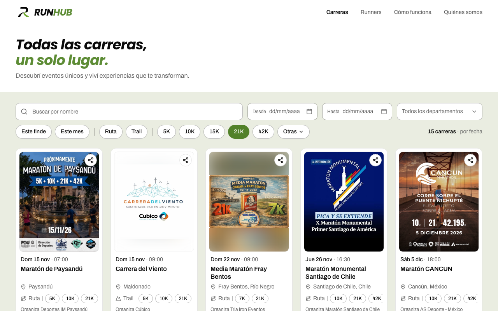

# Real assets and the deferred checks — plan
Spec: `docs/specs/2026-11-real-assets.md` (approved). Tier A. One PR, branch
`feat/real-assets-and-checks`.

QA: skip — static checks with deterministic self-tests; nothing interactive or stateful to explore.

## Files
| File | Change |
|---|---|
| `luraschi-cv.pdf`, `img/runhub.png`, `img/marginalia.png` | Added (task 1, main session only) |
| `index.html` | LinkedIn href, Marginalia `alt` (task 2, main session only) |
| `scripts/check.py` | `EXCLUDED` removed; `srcset` URLs; `check_placeholders` |
| `tests/test_check.py` | Tests for tasks 2–5 |
| `tests/fixtures/` | New fixtures, one defect each (names below) |
| `docs/specs/2026-11-site-checks.md`, `AGENTS.md`, `docs/architecture.md` | Task 6 |

## Tasks
Tasks 1–2 are done by the main session before delegation; the implementer never touches an asset
or `index.html`. Tasks 3–6 are test-first: write the failing test, see it fail for the right reason,
then the code.

1. **Assets (SC1–SC4, SC6, AC1 size).** Main session, before staging anything:
   - Run the stdlib PDF inspection (kept outside the repo) on the approved CV: one xref section, one
     `%%EOF`, no `/Prev`, no unreferenced objects, every stream decompressed; outline, `/Dests`,
     `/Names` and `/Annots` listed; the only email-shaped string and `mailto:` are the owner's.
   - Search for the removed reference names and the REFERENCES heading (case-insensitive, with
     and without accents) in the per-font decoded text, every decompressed stream, the raw bytes
     and the outline titles: zero hits. The search script and its strings stay outside the repo.
     Record the results, without searched-for strings, for the PR.
   - Check each PNG: 1280x800, chunks limited to critical and colour chunks.
   - Copy the three files from the scratchpad by explicit path; each sha256 equals its approved
     value; stage by explicit path only.
2. **Copy edits (AC4).** LinkedIn href and Marginalia `alt`, exactly as AC4; a test in
   `tests/test_check.py` asserts both exact values in `index.html`; `scan.py` 0 hits.
3. **Exclusions gone (AC1).** Delete `EXCLUDED`, its comment and its use in `_check_url`, and
   `test_excluded_paths_are_exactly_the_three_placeholders`. Existing missing-asset fixtures keep
   failing; `LinksTest.test_site_pages_pass` now covers the real assets.
4. **`srcset` (AC3).**
   - `_srcset_urls(value)`: the candidate URLs of a `srcset`, per the HTML parsing rule: skip
     whitespace and commas; the URL is the run of non-whitespace; trailing commas are stripped from
     it and end the candidate; otherwise skip the descriptors up to the next comma outside
     parentheses.
   - `check_links` checks each internal candidate of `srcset` (`img`, `source`) and `imagesrcset`
     (`link`) through `_check_url`; `external_urls` adds the http(s) and protocol-relative ones.
   - Fixtures:
     - `srcset-missing-candidate.html`: `` → one
       `missing-target` naming `missing.png`.
     - `srcset-source.html`: `<picture><source srcset="missing.png 2x"></picture>` → one `missing-target`.
     - `srcset-comma-url.html`: `/img/a,b.png 2x` → one problem naming `/img/a,b.png`.
     - `srcset-outside-root.html`: `%2e%2e/%2e%2e/x.png 2x` → `outside-root`.
     - `srcset-imagesrcset.html`: `<link rel="preload" as="image" imagesrcset="missing.png 2x">`
       → `missing-target`.
     - `srcset-empty.html`: `srcset=""` → no problem.
     - `srcset-external.html`: `` and
       `<link … imagesrcset="http://cdn.test/c.png 2x">` → `check_links` reports nothing;
       `external_urls` returns `https://cdn.test/a.png`, `https://cdn.test/b.png`,
       `http://cdn.test/c.png`.
   - Unit tests for `_srcset_urls`: descriptors `1x`, `640w`; no descriptor; comma inside a URL;
     extra whitespace and commas.
5. **Placeholders (AC2).** `check_placeholders(path)` → `Problem(path, "placeholder", "line N:
   <match> in <text|comment|attribute name>")`, the match being the whole token. A parser of its
   own (an `HTMLParser` collecting text, comments and attributes with their lines), so `Page` stays
   unchanged.
   - Text, comments and every attribute value: `\bYOUR-[A-Z][A-Z0-9_-]*`;
     `\b(?:TODO|TBD|FIXME|XXX)\b` (case-sensitive); `lorem\s+ipsum` (any case).
   - `href`, `src`, `action`, and each `srcset`/`imagesrcset` candidate: the host is
     `example.com|org|net` or ends with `.example.com|org|net` (protocol-relative included).
   - Any `href` that is `#`, empty, or whitespace only.
   - `main()` runs it on both pages.
   - Fixtures, one defect each: `placeholder-marker-text.html`, `placeholder-marker-comment.html`,
     `placeholder-marker-attribute.html` (each `YOUR-HANDLE`; the test asserts the message holds
     `YOUR-HANDLE` and the defect's line); `placeholder-word.html`, `placeholder-lorem.html`
     (`Lorem Ipsum`), `placeholder-example-host.html`, `placeholder-hash-href.html` (`href="#"`),
     `placeholder-empty-href.html` (`href=" "`); and `placeholder-clean.html` holding `todo`,
     `Todos`, `XXXL`, `https://example.company.com/`, `href="#main"` → no problem.
   - Variants by `subTest` on generated pages (temp files): each of `TODO`, `TBD`, `FIXME`,
     `XXX`; hosts `example.com`, `example.org`, `example.net`, `www.example.com`,
     `//example.net/x`; attributes `href`, `src`, `action`, `srcset` candidate.
   - Each fixture: exactly one problem, rule `placeholder`; `check_forbidden` and `check_links`
     report nothing on it. Both site pages: no problem.
   - A `MainTest` case: a page with `YOUR-HANDLE` exits 1 naming `index.html: placeholder:`.
6. **Docs (AC6).** Site-checks spec **Status:** done. AGENTS.md: "Still to add" names only
   `CNAME`. `docs/architecture.md`: the `scripts/check.py` sentence adds the placeholder and
   `srcset` checks.
7. **Verify and close (AC5, SC2, SC5, SC6).**
   - `npm run check` green with coverage ≥85% on `scripts/check.py`; `scan.py` 0 hits.
   - `git diff --stat main` lists only the files above.
   - Each committed blob's sha256 matches its approved value; the PR body records the three hashes
     and task 1's inspection results.
   - Before the push, `scan.py` also runs over the commit messages and the PR body draft (saved
     outside the repo).
   - After the PR opens: delete the scratchpad's browser profile (the test account's session) and
     the CV drafts.

## Tests ↔ criteria
AC1 → task 3 and `test_site_pages_pass`; AC2 → task 5; AC3 → task 4; AC4 → task 2; AC5 → task 7;
AC6 → task 6 (review). SC1–SC4, SC6 → tasks 1 and 7 (main session); SC5 → task 7 and binds the
implementer: no private value in any fixture, test or message.

## Commands
- Tests and coverage: `npm run test:py`. Everything: `npm run check`.
- Setup if missing: `python3 -m venv .venv && .venv/bin/pip install --require-hashes -r requirements-dev.txt`.

## Decisions from conversation
- Placeholder tokens are case-sensitive; `lorem ipsum` is not. Empty `srcset` passes this rule.
- The asset preparation and verification scripts stay outside the repo.
- `MainTest.make_root` copies only the pages and `style.css`: with `EXCLUDED` gone, a temp root
  reports missing assets too; tests on a temp root assert on the rule they target, not on a clean
  run.
- 2b: see the spec's §4.
